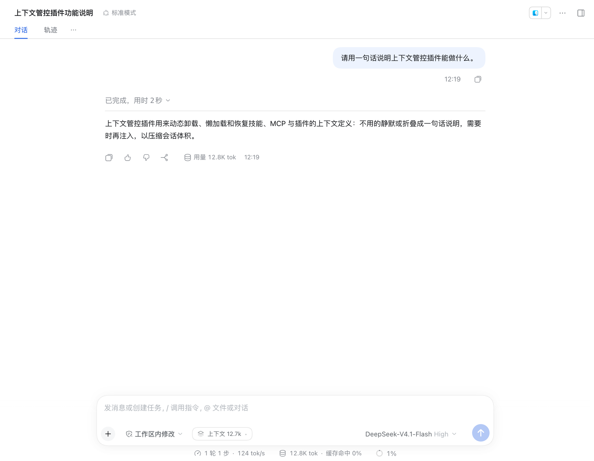
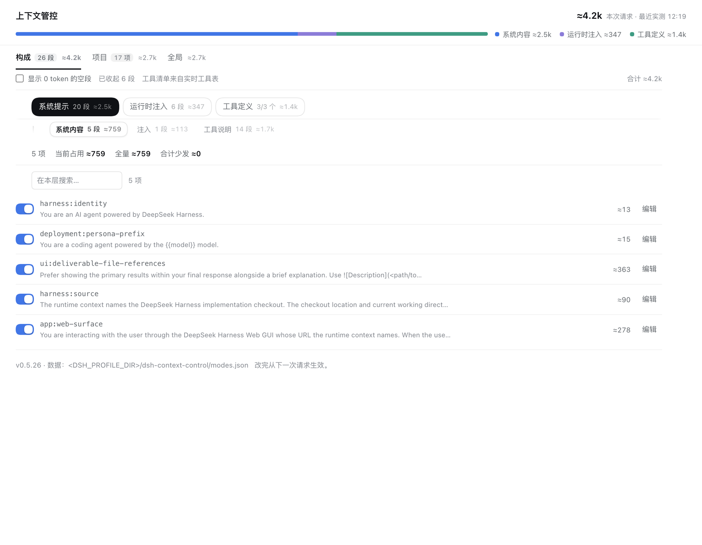
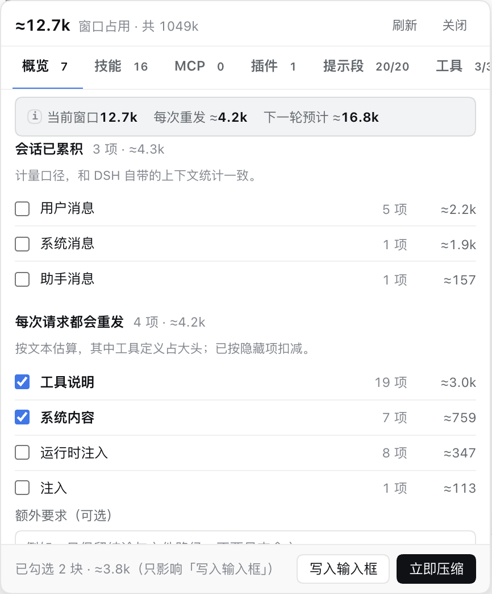
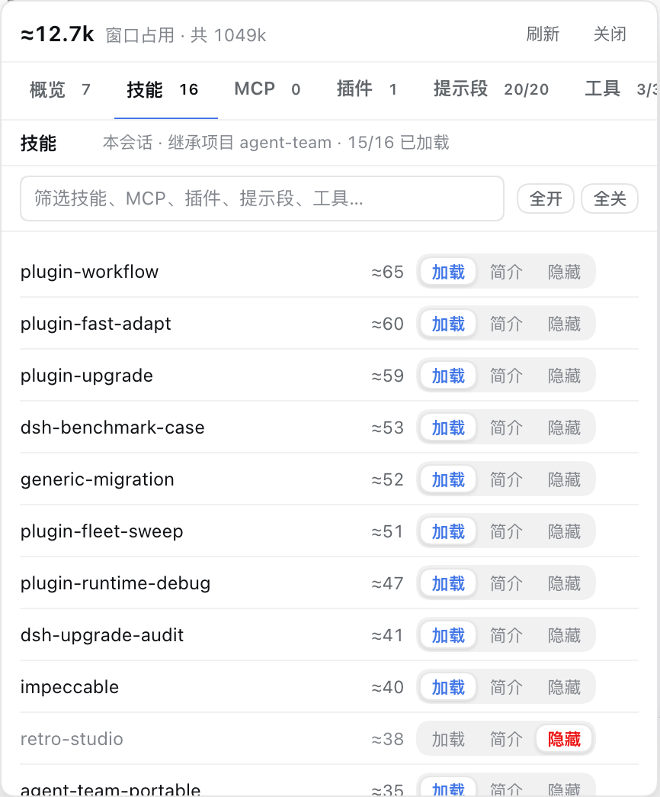
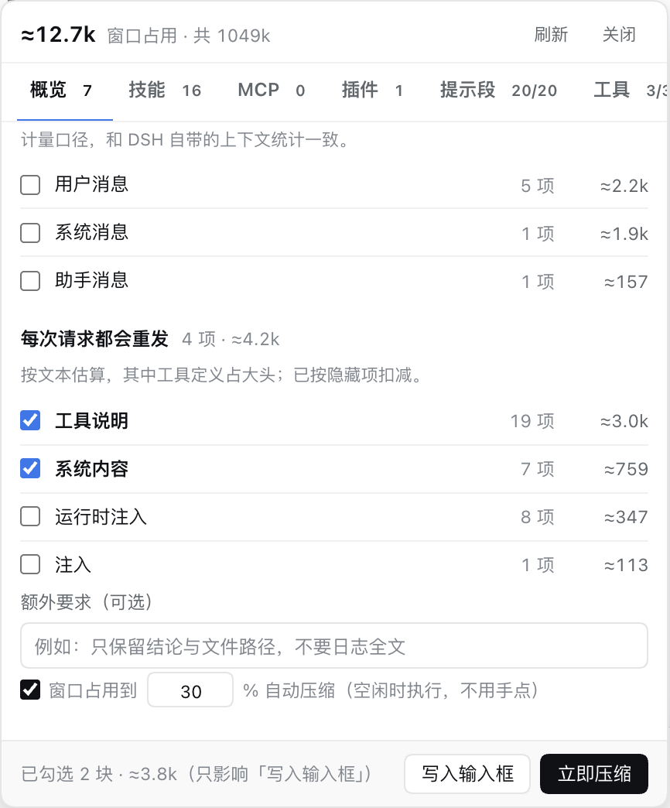

<div align="center">
  
</div>

# dsh-context-control

**Context control for DeepSeek Harness.** 看清 token 花在哪，再决定这一轮发什么。

[](https://github.com/creatjy/dsh-context-control/releases)
[](LICENSE)

DSH 的上下文里，很多内容每一轮都会重发：系统提示、工具定义、技能与 MCP 说明、其他插件注入的上下文。会话越长，旧消息还会继续挤占窗口。这个插件把两部分拆开处理：

- **请求侧**：看清系统提示、运行时注入、工具定义各占多少，逐段开关、编辑或保留简介。
- **会话侧**：按会话懒加载技能 / MCP / 插件，必要时立即压缩或到阈值自动压缩。

它不改 DSH 的日志，也不改插件源码。所有开关和改写都只作用于“下一次请求的装配结果”，随时可以还原。

## 入口

| 入口 | 回答的问题 | 能做什么 |
| --- | --- | --- |
| **左侧「上下文管控」配置台** | 整个请求由什么组成？ | 按系统提示 / 运行时注入 / 工具定义拆 token；逐段开关、编辑、还原；配置项目与全局规则。 |
| **输入框左侧的上下文胶囊** | 这条会话现在占多少？下一轮还会发什么？ | 看当前窗口、每次重发、下一轮预计；按会话切换技能 / MCP / 插件档位；开关提示段与工具；立即压缩或设置自动压缩。 |

### 左侧配置台：看全局，也改全局



顶部一根三段比例尺（系统内容 / 运行时注入 / 工具定义），下面按「构成 / 项目 / 全局」组织：

- **构成**：当前项目实际会发出的全部内容，按来源和类型分组。
- **项目**：这个工作区的规则，可被子项目继承。
- **全局**：所有项目共享的默认值。

每一段、每个工具都有 token 估算和开关；系统提示段与运行时注入还带「编辑」入口。

### 会话胶囊：这一轮发什么



胶囊与 DSH 的上下文统计同口径。点开后是三层数字：

- **当前窗口**：会话已经占用的真实值。
- **每次重发 ≈**：下一轮还会再发的系统提示与工具定义，已扣掉本会话隐藏项。
- **下一轮预计 ≈**：两者相加，只是粗估。

下面按「会话已累积 / 每次请求都会重发」列明细。勾选模块只影响「写入输入框」；真正的「立即压缩」由宿主选择安全区间，不需要勾选。

## 安装

从 GitHub 直装：

```sh
dsh plugin add github:creatjy/dsh-context-control
```

或下载 [Release](https://github.com/creatjy/dsh-context-control/releases/latest) 里的 tarball：

```sh
dsh plugin add ./dsh-context-control-0.6.5.tgz
```

安装后重启 DSH，再刷新 Web GUI。左栏会出现「上下文管控」，输入框左侧会出现 `上下文 12.7k ▾` 这样的胶囊。

### GitHub Packages（npm）

同一份代码也会发布到 GitHub Packages，包名为 `@creatjy/dsh-context-control`。GitHub Packages 的 npm registry 需要先认证（即使是公开包）：

```sh
npm login --scope=@creatjy --auth-type=legacy --registry=https://npm.pkg.github.com
npm config set @creatjy:registry https://npm.pkg.github.com
dsh plugin add @creatjy/dsh-context-control
```

## 核心能力

### 1. 先看清：请求侧和会话侧分开算

DSH 的“上下文占用”其实由两部分组成，混在一起看很容易误判：

- **请求侧（每一轮都会重发）**：系统提示段、运行时注入、技能说明、工具定义。
- **会话侧（已经累积在窗口里）**：用户消息、助手消息、工具调用与工具结果。

插件把两部分分开列。请求侧按来源分组，每项带 `≈token`、预览和开关；会话侧直接读 DSH 的 `tokenMeter`，所以“会话已累积”的合计就是胶囊和 DSH 显示的当前窗口，不会互相打架。



### 2. 逐段编辑系统提示词，以及其他插件的运行时注入

这是本插件和“只看统计”的工具最大的区别：**不只看，还能改这一轮发什么**。

在左侧配置台的「构成」里：

| 对象 | 能看到 | 能做什么 | 作用域 |
| --- | --- | --- | --- |
| **系统提示段**（sections） | 段名、来源、预览、≈token | 开关、编辑文本、还原 | 全局 / 项目 / 本会话 |
| **运行时注入**（contexts） | 注入名、来源、预览、≈token | 开关、编辑文本、还原 | 全局 / 项目 |
| **工具定义**（tools） | 工具名、所属能力、schema 体量 | 开关 | 全局 / 项目 / 本会话 |
| **技能 / MCP / 插件** | 条目、简介、所属段与工具 | 加载 / 简介 / 隐藏 | 全局 / 项目 / 本会话 |

具体来说：

- **系统提示段**来自 DSH 自身、技能、MCP 和其他插件。像 `harness:identity`、`tool:bash`、`agent-teams:usage`、`mcp:github` 这类段都会单独列出；点「编辑」会打开一个带实时字符数 / token 估算的编辑器。
- **运行时注入**是宿主或其他插件在请求前塞进上下文的内容。它们和系统提示段分开列，可以单独关掉，也可以改写后再发。
- **编辑不是改源码**。保存后只写一条本地规则；下一次装配时用你的文本替换这一段。原段落仍然由宿主 / 插件生成，点「还原」即可回到原样。
- **隐藏一个能力会连带裁剪**。把某个技能 / MCP / 插件设为「隐藏」后，它附带的工具定义和提示段会一起从装配结果里摘掉，而不是只藏一个名字。
- **工具定义只能开关，不能改文本**。工具 schema 是结构化协议，改文本会破坏调用；需要减少工具就关掉整个能力，或按工具逐个 deny。

编辑器和规则都只影响当前作用域。改完从下一次请求开始生效；关闭面板不会自动回滚。

### 3. 技能 / MCP / 插件：三档懒加载

| 档位 | 这一轮发什么 | 模型调用时 |
| --- | --- | --- |
| **加载** | 正文、工具定义都在 | 正常调用 |
| **简介** | 只留一行说明，正文与工具不发 | 自动恢复完整内容，不用确认 |
| **隐藏** | 连简介也不发 | 先弹审批；拒绝则这次调用失败 |

三档作用于**本会话**：只影响当前这条会话，不改项目配置。行内标「本会话」，`↺` 只撤掉会话覆盖。切换项目或改开关后，旧的实测快照会立即失效，避免拿上一轮数字冒充这一轮。

系统提示段与系统工具没有「简介」档，只有加载 / 不加载；它们同样可以按项目、全局或本会话覆盖。

所有筛选框都带「全部状态 / 已开启 / 已关闭」下拉，可和文本搜索叠加；列表很长时先筛状态、再按名字找更快。

没有安装或启用懒工具箱时，技能页会扫描当前工作区与用户目录下的技能文件，仍然显示「加载 / 简介 / 隐藏」三档；token 按目录行估算，档位会保存，安装或启用工具箱后生效。

### 4. 会话内压缩：立即压，或到阈值自动压



- **立即压缩**：宿主暴露压缩服务时，由 DSH 选择可压缩区间并真正折叠历史；本轮还在跑时会排队，结束后执行。
- **自动压缩**：窗口占用达到设定比例（5%–95%）后，在空闲时执行；忙碌时排队，不会打断当前轮。
- **没有压缩服务时**：按钮变成「发送压缩指令」，把勾选模块与额外要求作为一条 steer 指令发给模型，让模型就地折叠。这条路径不硬改会话日志，可回滚。

### 5. 项目继承 + 全局默认

项目按会话 `cwd` 前缀最长匹配，子项目可以继承父项目；项目层之上还有全局层。优先级从低到高：

```
全局 → 项目继承链 → 项目自己的覆盖 → 本会话覆盖
```

批量「全开 / 全关」写的是显式值；想回到继承值，点行内的「继承」或 `↺`。会话层不会改写项目配置，下一次新会话仍按项目/全局规则走。

### 6. 只改「发不发」，不硬改日志

请求侧裁剪挂在 `system-prompt/assemble` 上：先让 DSH 完成装配，再按规则删段、换段。工具开关走 `agent.ctx.tools.restrict({ deny })`，按 agent 分别限制。会话压缩走宿主压缩服务；没有服务时才退回提示词路径。

## AI 建议（0.6.0 起，默认关闭）

在配置台或胶囊里点一次，才把**当前作用域**的条目元数据交给当前会话的模型：

- 全局页只写全局层，项目页只写当前项目，构成页写当前模式，胶囊只写本会话。
- 每条建议带 `reason / confidence / risk / 预计少发`；低置信度不会写成确定结论。
- AI 入口只有 4 个：上下文管控的「构成 / 项目 / 全局」各一个，胶囊弹窗刷新旁一个；MCP、插件、提示段、工具等明细行不再单独放 AI 按钮。
- 先预览、勾选，再「应用选中」；应用后可「撤销」。不会自动改配置，也不改源码。
- 文件读写、shell、压缩、上下文管控自身等基础能力受保护，只允许保留或简介。
- 首次启用会提示隐私范围：发送的是条目名称、类型、token 数，不发送会话正文。

完整契约见 [AI建议-架构方案.md](./docs/AI建议-架构方案.md)，界面见 [AI建议-UI设计.md](./docs/AI建议-UI设计.md)。

## 典型用法

- **长会话越跑越慢**：打开胶囊，把当前用不到的 MCP / 插件设为「简介」或「隐藏」，再点「立即压缩」。
- **某个插件注入太吵**：左侧配置台 →「构成」→「运行时注入」，找到对应来源，先关掉；需要保留结构就点「编辑」压成一句话。
- **系统提示太长**：在「系统提示」里按段看 `≈token`，把大段说明改写成本项目真正需要的规则，或直接关掉不用的工具说明。
- **不想每次手动调**：给项目设一套默认规则，再在会话里只覆盖当前需要的几项。

## 数字怎么读

| 数字 | 来源 | 用在哪 |
| --- | --- | --- |
| 当前窗口 | `contextPressure().pressureTokens` | 胶囊、会话卡片 |
| 每次重发 ≈ | 系统提示 + 工具定义，按字符估算 | 概览第二数 |
| 下一轮预计 ≈ | 当前窗口 + 每次重发 | 概览第三数 |
| 日志累计 | `measure().totalTokens` | 会话卡片副标题 |

「当前窗口」是日志尾部：从最新一条往前累到窗口占用为止；所以会话侧分模块相加正好等于窗口占用，不会和标题打架。

## 数据与隐私

- 规则只写本地 `<DSH_PROFILE_DIR>/dsh-context-control/modes.json`，纯 JSON，可手改。
- 插件不额外上传会话内容；token 统计在本地完成。
- 删掉 `modes.json` 等于恢复默认：全部加载、无项目覆盖。
- 「隐藏」依赖审批；如果全局关闭了审批，隐藏项调用会直接失败，而不是静默放行。

## 边界

- 带 `≈` 的是估算值，不是账单；真实会话侧数字以计量器为准。
- 把工具全关掉，模型确实没有工具可用；界面会提示，但不会替你拦。
- 「简介」自动恢复只作用于当前会话；新会话仍按项目/全局规则。
- 压缩是否可用取决于当前 DSH profile 是否暴露压缩服务；没有时只能走 steer 指令。
- 本项目在 DSH（DeepSeek Harness）上开发，验证环境为 macOS；其他操作系统或运行环境可能存在差异，欢迎反馈。

## 文档

- [需求与技术方案](docs/需求与技术方案.md)：规则模型、装配裁剪、压缩流水线、API 与实测数据。
- [UI 设计](docs/UI设计.md)：布局、tokens、组件规格、六个页面与交互。
- [能力精简与冲突分析](docs/能力精简与冲突分析-需求与规划.md)：能力目录、冲突与迭代规划。

## 相关项目与致谢

- [DeepSeek Harness](https://github.com/deepseek-ai/deepseek-harness)：本项目的宿主与开发环境。感谢其插件机制、API 与文档支持。
- [dsh-context](https://github.com/bowenliang123/dsh-context)：DSH 的上下文仪表盘与浏览器，支持跨会话查看上下文构成、演变和 `/context` 命令。推荐给需要更深入分析上下文构成的用户；本项目在「先看清、再裁剪」的产品方向上也受益于它的探索。感谢作者 bowenliang123 与所有贡献者。

## 开发

无构建步骤，改完 `lib/` 或 `client.js` 后重启 DSH、刷新 Web GUI 即可。发布前可以跑：

```sh
node --check lib/index.js
node --check client.js
npm pack --dry-run
```

## License

MIT © creatjy
