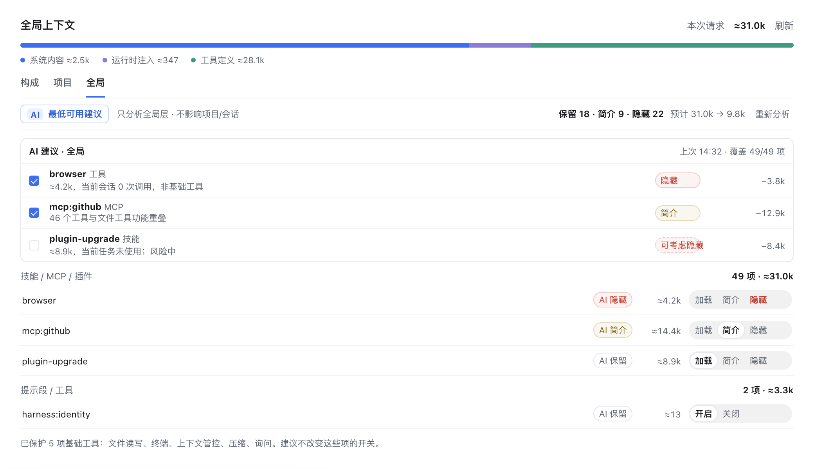
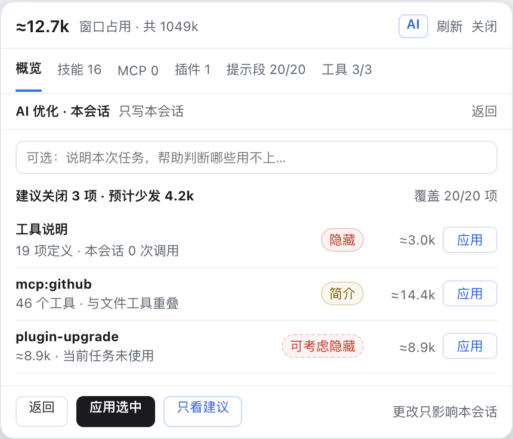

# AI 建议 UI 设计（规划）

- 基线：`0.5.30`，`client.js` 的面板/胶囊现有结构。
- 状态：设计稿 v2，已按 [AI建议-方案评审.md](./reviews/AI建议-方案评审.md) 的 t3 UX 结论修订；未实现运行时代码。
- Impeccable 模式：Operate。做的是 Refinement，保留现有视觉世界，不引入新风格。
- 关联：[UI设计.md](./UI设计.md)、[需求与技术方案.md](./需求与技术方案.md)、[能力精简与冲突分析-需求与规划.md](./能力精简与冲突分析-需求与规划.md)、[AI建议-架构方案.md](./AI建议-架构方案.md)。





> 示意图为静态设计稿，源文件：`docs/mockups/ai-ui.html`；截图目前只覆盖全局页与胶囊（`docs/images/ai-panel.png`、`docs/images/ai-capsule.png`）。项目页、构成页、行内详情在 §3 给文字线框，mockup 补齐后再补截图。

## 1. 设计目标

AI 建议只解决一个问题：**在当前这一层，告诉你哪些项可以保留、简介、隐藏或改写，并给出依据。**

它不是聊天窗口，不是一次性批量报告，也不是自动优化器。界面遵守四条：

1. **建议不是结论**：每条建议都有 reason、confidence、risk、savedTokens；低置信度不写成确定结论。
2. **点击才发生**：打开页面、切页、开胶囊都不发请求；点哪个作用域，只分析哪个作用域。
3. **作用域可见**：全局页只写全局层，项目页只写当前项目，构成页只写当前模式，胶囊只写本会话。
4. **先预览再写**：默认不改配置；应用前可看 diff/变更清单；应用后可撤销。

## 2. 作用域与入口

入口动词统一为名词短语 `AI 建议 · <层>`；“最低可用”只作为全局页副标题，不再用「优化 / 分析 / 最低可用建议」三种动词。

| 入口 | 作用域 | 建议对象 | 写入层 | 入口文案 | 副标题 |
| --- | --- | --- | --- | --- | --- |
| 面板 · 全局 | `global` | 技能/MCP/插件、提示段、工具 | 全局 | `AI 建议 · 全局` | `最低可用 · 只分析全局层` |
| 面板 · 项目 | `project` | 当前项目的同一组明细 | 当前项目 | `AI 建议 · 项目` | `只写当前项目 · 不改全局/会话` |
| 面板 · 构成 | `parts` | 系统提示段、运行时注入、工具 | 当前模式 | `AI 建议 · 构成` | `只写当前模式` |
| 胶囊 · 页头 | `session` | 本会话能力、提示段、工具 | 会话 | `AI 建议 · 会话` | `只写本会话` |
| 行内 · 单项 | `item` | 当前一行 | 该行的父层 | `AI` ghost 按钮 | title `AI 建议 · 单项` |

行内单项是补充入口，不替代页面级分析。页面级分析一次覆盖当前页全部明细；行内 AI 只补某一项。

## 3. 页面布局

### 3.1 面板 · 全局页

```text
（以下为点击展开后的状态）
全局上下文                                          本次请求 ≈31.2k   刷新
[======== 系统内容 ========][== 运行时 ==][==== 工具定义 ====]
构成   项目   全局
────────────────────────────────────────────────────────────────
全局层   [AI 建议 · 全局]  最低可用 · 只分析全局层     [只看建议 30]  [重新分析]
────────────────────────────────────────────────────────────────
AI 建议 · 全局                                     [仅分析本层 ▾]
保留 18 · 简介 9 · 隐藏 22 · 预计少发 20.5k（31.2k → 10.7k）
依据：4 项能力当前会话 0 次调用；2 项与已加载能力功能重叠。
[应用选中]  [只选低风险]                         上次 14:32
────────────────────────────────────────────────────────────────
☑ browser                         [建议隐藏]  ≈3.0k → 0        [加载|简介|隐藏]
☐ mcp:github                      [建议简介]  ≈14.4k → ≈3.1k   [加载|简介|隐藏]
☐ harness:identity                             ≈13           [开关] [编辑]
…
────────────────────────────────────────────────────────────────
已保护基础工具：文件读写、搜索、终端、上下文管控、压缩、询问
```

- AI 入口**默认收起**：页头行右侧一个 22px 高的 ghost 按钮；点击才展开 37px 的 `AiStrip`。常驻不占首屏，点击前无收益的问题消失。
- 展开后 strip 只放入口/状态/筛选/重新分析；**「应用选中」只出现在 AiCard**，不在 strip 重复。
- `AiCard` 是 strip 下方展开的扁平区域；没有结果时不显示。
- 结果行显示数量与预计少发，不写「节省 90%」这类夸张文案。
- 已评估但保留的项**不显示 pill**（18 个「AI 保留」只是噪音）；keep 数只在结果卡汇总里出现。
- 未生效建议用虚线边框 + 半透明底，文案一般以「建议」开头：`建议隐藏` / `建议简介` / `建议改写`；低置信+高风险组合用 `可考虑隐藏 · 需确认`；已应用后换成实线 + `已应用`。
- `只看建议 30` 是按下态按钮，不是下拉；按下后只显示非 `keep` 的项。
- 首次点击后结果卡/行内提示才出现；再次进入页面不自动恢复上次结果（缓存只在同一页面会话内）。

### 3.2 面板 · 项目页

```text
项目 · default-workspace
[AI 建议 · 项目]  只写当前项目 · 不改全局/会话
─────────────────────────────────────────────────────────────
AI 建议 · 项目                                      [仅分析本层 ▾]
打开 3 · 简介 6 · 隐藏 9 · 预计少发 20.6k（24.6k → 4.0k）
[应用选中] [只选低风险]
─────────────────────────────────────────────────────────────
plugin-upgrade       [建议简介]  ≈8.9k → ≈2.7k   [加载|简介|隐藏]
mcp:github           [建议隐藏]  ≈14.4k → 0      [加载|简介|隐藏]
  ↑ 继承自全局层；应用到本项目会新增项目层覆盖
…
```

布局说明（与全局页同构，差异只在数据与提示）：

- 页头显示项目名与继承链；行内若值来自全局/父项目，标 `继承` 来源，AI 建议写当前项目层时提示「新增本层覆盖」。
- 结果卡的「打开/简介/隐藏」是**目标状态**，不是动作；应用时映射到项目层原语。
- 切换项目立即清空结果；未完成请求的回包丢弃。
- 不做成表格卡片：沿用全局页的三列（名称 / 建议 / token / 现有开关），只是数据换成项目层与继承差集。

### 3.3 面板 · 构成页

```text
系统提示 20 段 ≈2.5k   [AI 建议 · 构成]  [只看建议 6]  [只看可改写 3]
──────────────────────────────────────────────────────────────────
[开关] harness:identity        ≈13    [编辑]
[开关] deployment:persona…     [建议简介]  ≈15    [编辑]
[开关] ui:deliverable…         [建议改写]  ≈363   [编辑] [AI 改写]
…
```

- 页级结果覆盖当前模式；工具定义只给开关建议，不提供文本改写。
- 构成页不提供能力档位（cap）与技能行建议：现有 `setRule` 没有 cap 存储，技能也不是独立规则。
- 可编辑行多一个 `AI 改写`，打开 diff：

```text
┌ system prompt · ui:deliverable ───────────────────────────────┐
│ 原文  ≈25 tokens                                             │
│ You are an AI agent powered by DeepSeek Harness. Always       │
│ follow the user's instructions and keep answers concise.      │
│                                                              │
│ AI 版  ≈15 tokens                                            │
│ You are a DeepSeek Harness agent. Follow user instructions;   │
│ keep answers concise.                                        │
│                                                              │
│ [替换为 AI 版]   [还原]   [关闭]                              │
└──────────────────────────────────────────────────────────────┘
```

- diff 用行内展开，不用 modal；一次只展开一项。
- 原文与 AI 版必须是**真实缩短**的同一段文本，token 数随文本变化；不能出现原文与 AI 版文字相同却写 13→9。
- `替换为 AI 版` 写当前模式规则；`还原` 恢复打开 diff 前的文本；应用后按钮变 `已应用 · 还原`，焦点回到该行 `AI 改写`。
- `只看可改写` 只显示有 `editable:true` 且 AI 给出 rewrite 的项。

### 3.4 胶囊 · 会话 AI

```text
≈31.2k 窗口占用 · 共 1049k                    [AI]  刷新  关闭
概览 7   技能 16   MCP 0   插件 1   提示段 20/20   工具 3/3
──────────────────────────────────────────────────────────────
AI 建议 · 会话                              只写本会话   [返回]
[＋ 补充任务说明]   ← 默认收起，点击才展开输入
建议调整 3 项 · 预计少发 20.5k（31.2k → 10.7k）
☑ 工具说明          隐藏  ≈3.0k → 0
☐ mcp:github        简介  ≈14.4k → ≈3.1k
☐ plugin-upgrade    简介  ≈8.9k → ≈2.7k
另 4.9k 为其他模块（31.2k − 三项 26.3k）
──────────────────────────────────────────────────────────────
[应用选中]   [只看建议]   [撤销]
```

- 页头加 24×24 的 `AI` 按钮（含 `aria-label="AI 建议 · 会话"`），排在 `刷新` 前；不放 emoji。
- 点击后在浮层 body 内打开 AI sheet，不新开窗口；**sheet 打开时页签行隐藏**，关闭后回到原页签。全流程只有一个「返回」（sheet 右上角），页签行不再出现第二个返回。
- 浮层高度固定：body `overflow:hidden; min-height:0`，sheet 内容区 `flex:1 1 0; overflow:auto`，底部动作条固定；不靠「内容刚好不长」来维持高度。
- sheet 顶部一行说明「只写本会话」；任务说明输入默认收成 `＋ 补充任务说明`，点击展开，不占首屏。
- 建议按「建议隐藏 / 建议简介 / 建议改写」分组；每组先显示 5 条，滚动。
- 底部 `应用选中` 只写会话层；`撤销` 恢复本次应用前的规则，title `本次会话内可撤销（刷新后失效）`。
- 数字口径：页头 31.2k = 三项 26.3k + 其他 4.9k；隐藏项记 0，简介项记保留后的 ≈token，少发 = 逐项差值之和。禁止再出现「总占用 12.7k、单行 14.4k」这种矛盾。

### 3.5 行内 AI 与 `AiPopover`

行内 pill 点击后打开锚定 popover，不直接改配置：

```text
mcp:github   [建议简介]  ≈14.4k → ≈3.1k
             ┌──────────────────────────────────────┐
             │ 建议简介 · 中风险 · 低置信            │
             │ 依据：本会话 0 次调用；与 46 个工具重叠│
             │ 影响：可能影响 plugin-upgrade 的 3 个工具 │
             │ [应用此项]                    [关闭]  │
             └──────────────────────────────────────┘
```

- 锚点：pill 右下角，默认下方 6px；下方空间 < 220px 时翻到上方；左右夹在视口内 8px。
- 宽度 320px（窄屏 `min(320px, 100vw - 24px)`），最大高度 `min(60vh, 420px)`，内容区独立滚动。
- 内容：动作、风险/置信、reason、token 前后、影响 sub-line（有 impactScan 时）、应用/关闭。
- 关闭：`Esc`、点击外部、再次点 pill；关闭后焦点回到 pill。
- 键盘：pill `Enter/Space` 打开；popover 内 `Tab` 循环，`Esc` 只关 popover，不冒泡到 sheet/浮层。

## 4. 组件规格

### 4.1 `AiStrip` 页面级 AI 条

| 项 | 规则 |
| --- | --- |
| 形态 | 默认收起为页头 ghost 按钮（22px 高）；点击展开 37px 条 |
| 高度 | 固定 37px，控件 22px；不随摘要换行改变 |
| 背景 | 透明；上/下 1px `--cc-soft`，不加大卡片 |
| 布局 | 左：`AI 建议 · <层>` + 副标题；中：状态/摘要；右：`只看建议 N`、`重新分析` |
| 按钮 | 11.5px，蓝字 `--cc-on-text`，透明底；hover `--cc-hover` |
| 运行 | 按钮 disabled，文案 `正在分析全局层…`，下方 2px 进度条 |
| 结果 | `保留 18 · 简介 9 · 隐藏 22` + `预计少发 20.5k` |
| 失败 | `分析失败：…` + `重试`；错误色仅用于文字/细线 |
| 无模型 | 按钮 disabled，title `当前会话没有可用模型` |
| 隐私未启用 | 按钮 disabled，title `AI 建议默认关闭，需先了解会发送的内容` |
| 窄屏 ≤760 | 摘要省略为 `18/9/22`，按钮保持一行；高度仍 37px |

- strip 里**没有**「应用选中」；应用只在 AiCard，避免两处主按钮竞争。
- `AiStrip` 不常驻占位：收起时页面列表回到原位置，不保留 37px 空白。

### 4.2 `AiPill` 行内建议

| 类型 | 文案 | 颜色/形态 |
| --- | --- | --- |
| 保留 | 不显示 | —（keep 不产生行内噪音） |
| 简介 | `建议简介` | `--cc-warn-text`，`--cc-warn` 边框；未生效虚线 + 半透明底 |
| 隐藏 | `建议隐藏` | `--cc-err`；未生效虚线 + 半透明底 |
| 改写 | `建议改写` | `--cc-on-text`；未生效虚线 + 半透明底 |
| 低置信 + 高风险 | `可考虑隐藏 · 需确认` | 虚线 + `--cc-err` 文字；默认不勾选、不进批量 |
| 已应用 | `已应用` | 实线、`--cc-ink2`；点击打开 popover 可还原 |
| 未评估 | `AI 未评估` | 灰字，仅 partial/无结果时 |

- 11px，padding `2px 6px`，radius 99，1px 半透明边；列宽 `auto`，`min-width:72px`，不再用 58px 固定宽。
- pill 整行可点：行高 ≥40px，pill 只是视觉标签；触摸目标按整行算。
- 高风险加 `需确认` 文字，不用感叹号图标。
- 行 hover/focus 时，未分析的项在行尾出现 24×24 `AI` ghost 按钮；触摸设备常显 0.5 透明。

### 4.3 `AiCard` 结果摘要

```text
AI 建议 · 全局                                      [仅分析本层 ▾]
保留 18 · 简介 9 · 隐藏 22 · 预计少发 20.5k
依据：4 项能力当前会话 0 次调用；2 项与已加载能力功能重叠。
┌ 列表（独立滚动，tabindex=0，role=region） ──────────────────┐
│ ☑ browser        建议隐藏  ≈3.0k → 0      低风险            │
│ ☐ mcp:github     建议简介  ≈14.4k → 3.1k  中风险 · 低置信   │
│ ☐ plugin-upgrade 建议简介  ≈8.9k → 2.7k   中风险 · 低置信   │
│   影响：可能影响 mcp:github 的 3 个工具（推测）                 │
└────────────────────────────────────────────────────────────┘
[应用选中]  [只选低风险]
```

- 背景 `--cc-bg`，1px `--cc-line`，radius 8；列表最多 260px 高，内部滚动。
- 行高 28px；勾选框只在需要选择时出现；**风险/置信一律中文**（`低风险`、`中风险 · 低置信`），不显示 `medium/low`。
- 默认选中：仅 `risk=low` 且 `confidence!=low`，且非 blocked、非 impact block；medium/high 或低置信需手动；high 不选。
- `只选低风险`：清空其他勾选，只留 `risk=low && confidence!=low`；语义与默认一致，不写「全选低风险」。
- 卡头右侧（覆盖率/上次时间之后）放 `AiImpactToggle`，不放到 strip 主行。
- `blocked` 项：不显示勾选框，行尾 `不可应用` + title；批量应用会跳过/拒绝。
- 列表为空/无建议：`当前配置已经很精简，没有低风险建议。`
- 筛选后 0 条：`没有匹配的建议。` + `[清除筛选]`，不要复用「已经很精简」。

### 4.4 `AiDiff` 文本改写

```text
原文  ≈25 tokens
You are an AI agent powered by DeepSeek Harness. Always follow the
user's instructions and keep answers concise.
AI 版  ≈15 tokens
You are a DeepSeek Harness agent. Follow user instructions; keep
answers concise.
[替换为 AI 版] [还原] [关闭]
```

- 正文 11.5px / 1.55；不用代码字体，除非原文是代码。
- 原文背景 `--cc-hover`；AI 版背景 `rgba(59,110,240,.06)`。
- 只允许 sections/contexts；工具行不出现 `AI 改写`。
- 应用后：按钮区变 `[已应用 · 还原] [关闭]`，行内 pill 变 `已应用`，焦点回到该行 `AI 改写`。
- `还原` 使用 undoToken；过期/冲突时显示 `撤销已过期` / `配置已变化，未撤销`。

### 4.5 `AiFilter` 筛选

- 复用 `.cc-btn.is-ghost.is-mini`，加 `aria-pressed` 与 pressed 态。
- 文案带计数：`只看建议 30`、`只看可改写 3`。
- 没有 AI 结果时 disabled；有结果但计数为 0 时显示 `0` 并 disabled，title `没有符合条件的建议`。
- 与现有状态筛选、搜索叠加；切换页签重置。
- 筛选后 0 条显示空态与 `[清除筛选]`，不显示「没有建议」这种误导文案。

### 4.6 `AiConfirm` 应用确认

```text
应用 30 项到全局层？
低风险 18 · 中风险 9 · 高风险 3（未选）· 阻断 2（未选）
全局层变更会影响所有项目，应用后可撤销。
[取消] [确认应用]
```

- 内联在 AiCard 下方，不用 modal。
- 全局/项目/模式默认需要确认；会话开关可直接应用并保留撤销。
- 文本改写始终在 diff 里单独确认。
- 阻断项不计入批量；确认文案明确「阻断项需单项确认」。

### 4.7 `AiPopover` 详情层

| 项 | 规则 |
| --- | --- |
| 触发 | pill 点击 / `Enter` / `Space`；`aria-haspopup="dialog"` |
| 定位 | 锚点下方 6px，翻转让位；左右夹 8px；`position:fixed` |
| 尺寸 | 宽 320px（窄屏 `100vw-24px`）；`max-height:min(60vh,420px)` |
| 层级 | 高于 sheet 内容、低于全局 modal；`z-index` 单独变量 |
| 容器 | `role="dialog"` `aria-modal="false"` `aria-labelledby` |
| 焦点 | 打开时焦点进第一个可操作项；`Tab` 循环；关闭回 pill |
| 关闭 | `Esc`、外部点击、再次点 pill；`Esc` `stopPropagation` |
| 内容 | 动作、风险/置信、reason、token、impact sub-line、`[应用此项]` |
| 滚动 | 内容区 `overflow:auto`，头部/底部固定 |

### 4.8 `AiSheet` 会话详情

- `role="dialog"` `aria-modal="true"` `aria-labelledby="AI 建议 · 会话"`。
- 打开时隐藏页签行与共享页头，sheet 自己只有一个 `[返回]`；关闭回原页签。
- 页头（标题 + 返回）固定；说明行「只写本会话」；任务说明可折叠；结果区 `flex:1 1 0; min-height:0; overflow:auto`；底部动作条固定。
- 不改变浮层高度：打开/关闭 sheet 只换内容，不重算浮层 `maxHeight`。
- 430px：单列，按钮全宽；行内 token 可隐藏，只留建议与名称；`应用选中` 高 28px。

### 4.9 `AiImpactToggle` 影响分析开关

位置：

- `AiCard` 头部右侧，排在覆盖率/上次时间之后；
- 会话 sheet 中也可放在「只写本会话」说明下方的补充说明区，不与主按钮同行。

```text
AI 建议 · 全局                        上次 14:32  [仅分析本层 ▾]
```

| 状态 | 文案 | 说明 |
| --- | --- | --- |
| 关闭（默认） | `仅分析本层` | 不额外调用模型 |
| 开启 | `含其他插件/工具影响` | 勾选提示 `多 1 次模型调用 · +1.2s` |
| 不可用 | `仅分析本层` disabled | title 说明原因：没有本会话快照 / 无实时工具表 / 隐私未启用 |

- 默认否定式说明「仅分析本层」，勾选才是肯定式「含其他插件/工具影响」，避免用户误以为默认已经查了依赖。
- title 说明：「不勾选时只看本层证据，不检查其他插件/工具是否依赖这些项。」
- 切换**不自动发请求**，只把结果标 stale：`口径已变更，请重新分析。`
- 关闭开关时：清空 `impacts`、移除所有 sub-line、重算卡头「含影响分析 / N 项有阻断风险」计数；主建议与勾选不变。
- 证据不可用时开关 disabled，不显示「0 项影响」这种伪结果。

### 4.10 影响 sub-line

```text
影响：可能影响 plugin-upgrade 的 3 个工具（推测）
影响：与 terminal 插件共享 2 个工具，隐藏后可能不可用
影响：无法判断（证据不足）
```

- 11px，挂在建议行下方，不新开卡片；每条建议最多 1 行，超出省略。
- 降级（degrade）：`--cc-warn-text`；
- 阻断（block）：`--cc-err` + `需确认`，默认不勾选、不进批量；
- 未知（unknown）：`--cc-ink2`，不写成确定结论；
- 431px 以下最多显示 1 条，其余收成 `+N`，点击展开 popover 看全部。
- 卡头显示 `含影响分析` 与 `N 项有阻断风险`，后者可点击筛选。

## 5. 状态与文案

| 状态 | 显示 |
| --- | --- |
| idle / 收起 | 页头 ghost `AI 建议 · 全局` |
| running（页面） | `正在分析全局层…` + 2px 进度条；其他 AI 按钮 disabled |
| item running | 该行 pill `分析中…`，行尾按钮 disabled；其他行不受影响 |
| item error | 该行 `分析失败 · 重试`，不改其他行结果 |
| success | `保留 18 · 简介 9 · 隐藏 22` + `预计少发 20.5k` |
| empty | `当前配置已经很精简，没有低风险建议。` |
| partial | `只覆盖 24/30 项` + `重新分析`；未覆盖项标 `AI 未评估` |
| partial invalid | `2 项不支持当前层写入，已跳过` + 查看详情 |
| error | `分析失败：模型返回格式不正确，未改动配置。` |
| stale | `配置已变化，请重新分析。` |
| stale-impact | `口径已变更，请重新分析。` |
| no-model | 按钮 disabled；title `当前会话没有可用模型，AI 建议不可用` |
| privacy-off | 按钮 disabled；title `AI 建议默认关闭，需先了解会发送的内容` |
| busy（页面） | 其他入口 title `正在分析全局层，请稍候`；当前入口显示进度 |
| busy（行内/sheet） | 行内 `等待当前分析结束…`；sheet 底部按钮 disabled |
| applied | `已应用 30 项 · 少发 21.2k` + `撤销` |
| apply-failed | `应用失败，未改动任何配置（全有或全无）` + 失败项 |
| apply-skipped | `2 项在应用前被过滤，未写入` + 列出原因 |
| undo-expired | `撤销已过期`；按钮移除 |
| undo-conflict | `配置已变化，未撤销` + `重新分析` |
| filter-empty | `没有匹配的建议。` + `[清除筛选]` |
| sheet-reopen | 重新打开 sheet：结果清空回 idle，不自动恢复上次结果 |
| impact-off | 卡头 `含影响分析` 不出现；无 sub-line |
| impact-running | 开关旁 `正在补影响分析…`，主建议可继续看 |
| impact-error | `影响分析失败：…（主建议仍可用）`，不阻塞应用 |
| impact-blocked | 卡头 `含影响分析` + `2 项有阻断风险`，可筛选 |

文案原则：说「建议」不说「AI 认为」；说「预计少发」不说「节省」；错误说清「未改动配置」；风险/置信用中文。

## 6. 交互规则

1. 打开面板、切页、开胶囊：零请求。
2. 点页面级按钮：只发当前 scope；其他 scope 的按钮禁用但不发请求。
3. 点行内 AI：只发当前 item；结果只更新该行。
4. 同一会话只允许一个 AI 任务；服务端 409，客户端按 409 显示 busy。
5. 切换项目/页签/会话：清空当前结果；未完成请求的回包丢弃。
6. 缓存命中：显示 `上次分析 14:32` + `重新分析`；不自动重跑。
7. 应用：全局/项目/模式确认后写；会话开关直接写并给撤销。
8. 应用成功：刷新 state，行内 token 与规则立即更新；清缓存。
9. 撤销：内存栈、最多 20 条、1 小时；刷新页面即失效；冲突不硬写。
10. 冲突/不可关项：显示 blocked，不提供批量应用；说明「基础工具不可隐藏」。
11. 影响分析开关：切换只标 stale，不自动重跑；关闭即清空 impacts 并重算合计。
12. 阻断项：默认不勾选、不进批量；单项应用需 `需确认` 二次确认。

### 6.1 Esc 层级

从内到外只关一层，每层处理完 `stopPropagation()`：

```text
AiPopover 详情 > AiDiff > AiConfirm > AiSheet > 浮层
```

- popover 打开时，`Esc` 只关 popover；
- diff 打开时，`Esc` 先关 diff，再按一次才到 confirm/sheet/浮层；
- sheet 打开时，`Esc` 关 sheet 回原页签，不直接关浮层；
- 筛选框内 `Esc` 只清筛选词，不关层；
- 任何层都没有打开时，`Esc` 才关浮层。

### 6.2 焦点与 live region

- 打开 popover/sheet：焦点进容器第一个可操作项；关闭回到触发元素。
- 应用/撤销后：焦点回到该行或结果卡「撤销」，并在 live region 播报结果。
- 分析结束/结果出现/失败：统一一个 `aria-live="polite"` 区域，文案与状态表一致；不要每个 pill 各挂一个 live。
- diff 打开/关闭、确认出现：焦点进入对应容器，`Esc` 关闭后归位。
- `prefers-reduced-motion`：进度条改静态「分析中…」，展开/收起不做高度动画。

### 6.3 撤销生命周期

- 撤销栈只存在内存，按 `sessionId + scopeKey` 分组，最多 20 条，1 小时；
- 刷新页面/重载插件即失效；按钮 title 固定写「本次会话内可撤销（刷新后失效）」；
- 应用后立即可撤销；撤销成功按钮变 disabled，live region 播报 `已撤销 N 项`；
- 过期显示 `撤销已过期`；配置变化显示 `配置已变化，未撤销`，不提供强制覆盖；
- 会话剪枝导致部分旧值丢失时，显示 `已撤销，N 项无法恢复`。

## 7. 视觉与动效

- AI 只使用现有蓝色 `--cc-on` 作为强调，不引入紫色/渐变/发光；正文/小字用更深的 `--cc-on-text` (#2f5fd4) 保证对比度。
- 状态色：简介文字用 `--cc-warn-text` (#7a5a00)，`--cc-warn` 只做边框/弱底；隐藏 `--cc-err`；保留不出现 pill。
- **AI 区文字禁用 `--cc-ink3`**：正文、meta、原因、影响 sub-line 一律 `--cc-ink2`（≈6:1）；`--cc-ink3` 只留给非文字装饰。
- 进度条 2px，160ms 宽度过渡；`prefers-reduced-motion` 下改为静态「分析中…」。
- 展开/收起 160ms 高度过渡；不逐行入场。
- 不使用 emoji 当图标；`AI` 用文字 monogram 或 12px 自绘 SVG。
- 不新增阴影；结果区用 1px 边框和背景区分，不用悬浮卡片。

## 8. 响应式与无障碍

- 断点统一 **760px**（与现有面板一致）；不再使用 900/700–900 两套规则。
- ≥760px：strip 单行，摘要完整；<760px：摘要省略为计数，按钮一行，strip 高度仍 37px。
- 430px 胶囊：sheet 单列、按钮全宽；行内 token 可隐藏，只留建议与名称；`应用选中` 高 28px；AI 按钮 ≥24×24；pill 整行命中（行高 ≥40px）；影响 sub-line 最多 1 条 + `+N`。
- 所有 AI 按钮有 `aria-label`；`AiFilter` 用 `aria-pressed`；pill `role="button" tabindex="0"`；`AiCard` 列表 `role="region" tabindex="0"`；sheet `role="dialog" aria-modal="true"`；popover `role="dialog" aria-modal="false"`。
- 状态区 `aria-live="polite"`；对比度：正文/次要文本 ≥4.5:1；建议色只做文字/边框，不做大面积浅色底。
- diff 的「原文/AI 版」用标题而不是只靠颜色；键盘可完成打开、分析、查看、应用、撤销。

### 8.1 Impeccable 检测与修正

对 `docs/mockups/ai-ui.html` 跑 `impeccable detect` 后，修正了 AI 新增元素：

- 功能文字统一 ≥11px（原 9.5/10/10.5px 的 badge、pill、原因、meta 已上调）；正文仍用 12px。
- 原因/meta/影响 sub-line 改用 `--cc-ink2`；`--cc-ink3` 只保留给非文字装饰。
- 简介文字用 `--cc-warn-text`，`--cc-warn` 只做边框/弱底；蓝色文字用 `--cc-on-text`。
- 页签仍沿用现有 38px 单行结构，`.cap-tabs` 的贴底警告作为现有基线记录，不在本次改动。

复测仍余 2 条 11px 文字提示与 1 条页签贴底提示；11px 是面板高密度元信息的刻意下限。

## 9. 设计决策

- **不做聊天框**：AI 建议是审计工具的一部分，不是对话入口；聊天框会抢走页面主任务。
- **不做一次性大报告**：报告会过期、难定位；建议必须贴在对应行。
- **不做自动应用**：全局/项目层影响面大；默认只建议。
- **不新增卡片层级**：现有面板已经很密；AI 用 strip、pill、popover、diff 四种轻量形态。
- **保留/简介/隐藏**沿用现有三档，不发明第四种状态；keep 不产生行内 pill。
- **入口统一 `AI 建议 · <层>`**：动词不统一会让用户以为四个入口是不同能力；「最低可用」只做全局副标题。
- **影响分析默认关闭**：多一次模型调用与延迟；只在用户明确要求时查跨插件证据，且只做 advisory。

## 10. 验收清单

- [ ] 打开面板/切页/开胶囊，AI 请求数为 0。
- [ ] AI strip 默认收起；点击展开后高度 37px，收起不保留占位。
- [ ] 全局按钮只触发 `scope=global`；项目只触发 `project`；构成只触发 `parts`；胶囊只触发 `session`。
- [ ] 四个入口文案都是 `AI 建议 · <层>`；全局副标题为「最低可用」。
- [ ] 页面级结果只在当前页出现；切页/切项目后消失。
- [ ] keep 项没有行内 pill；未生效建议为虚线 + 「建议」前缀。
- [ ] 结果卡风险/置信为中文；低置信不写成确定结论。
- [ ] 默认只勾选低风险且非低置信；`只选低风险` 不会重新选回中风险。
- [ ] `应用选中` 只在 AiCard 出现一次；strip 无重复按钮。
- [ ] 全局/项目应用需确认；确认文案说明影响范围与阻断项。
- [ ] 应用后可撤销；撤销 1 小时/刷新失效；冲突不硬写。
- [ ] 文本 diff 只出现在 sections/contexts；工具无改写入口；原文与 AI 版真实缩短。
- [ ] 会话 sheet 数字自洽（31.2k = 26.3k + 4.9k），隐藏 = 0，简介 = 保留后 token。
- [ ] sheet 只有一个「返回」；打开时页签隐藏，关闭回原页签；浮层高度不变。
- [ ] 行内 pill 点击打开 popover；`Esc` 按层级逐层关闭；焦点归位。
- [ ] 430px 下 apply 28px、pill 整行命中、AI 按钮 ≥24×24。
- [ ] 无模型、隐私未启用、超时、坏 JSON、partial、stale、busy、undo 过期、筛选 0 条都有文案。
- [ ] 影响开关默认「仅分析本层」；勾选提示 +1 次调用；切换只标 stale 不自动重跑。
- [ ] 影响 sub-line 三种状态颜色正确；阻断项默认不勾选、不进批量。
- [ ] 关闭影响开关后 impacts 清空、合计重算，主建议不变。
- [ ] 键盘可完成：打开、分析、查看 popover、查看 diff、应用、撤销。

## 11. 实现映射

| 设计 | 组件/类 | 数据 |
| --- | --- | --- |
| 页面 AI 条 | `AiStrip` / `.cc-ai-strip` | `state.ai`, `aiResult` |
| 行内建议 | `AiPill` / `.cc-ai-pill` | `item.suggestion` |
| 结果摘要 | `AiCard` / `.cc-ai-card` | `suggestion.items/minimal` |
| 文本 diff | `AiDiff` / `.cc-ai-diff` | `item.text/currentText` |
| 筛选 | `AiFilter` / `.cc-ai-filter` | `onlyAi/onlyEditable` |
| 确认 | `AiConfirm` / `.cc-ai-confirm` | `pendingApply` |
| 会话 sheet | `AiSheet` / `.cc-ai-sheet` | `scope=session` |
| 行内详情 | `AiPopover` / `.cc-ai-popover` | `selectedItem` |
| 影响开关 | `AiImpactToggle` / `.cc-ai-impact-toggle` | `suggestion.impactScan` |
| 影响行 | `AiImpactLine` / `.cc-ai-impact` | `suggestion.impact.annotations` |

后端动作、模型路由、事务与护栏见 [AI 建议架构方案](./AI建议-架构方案.md)；本文件只锁定界面与交互。
